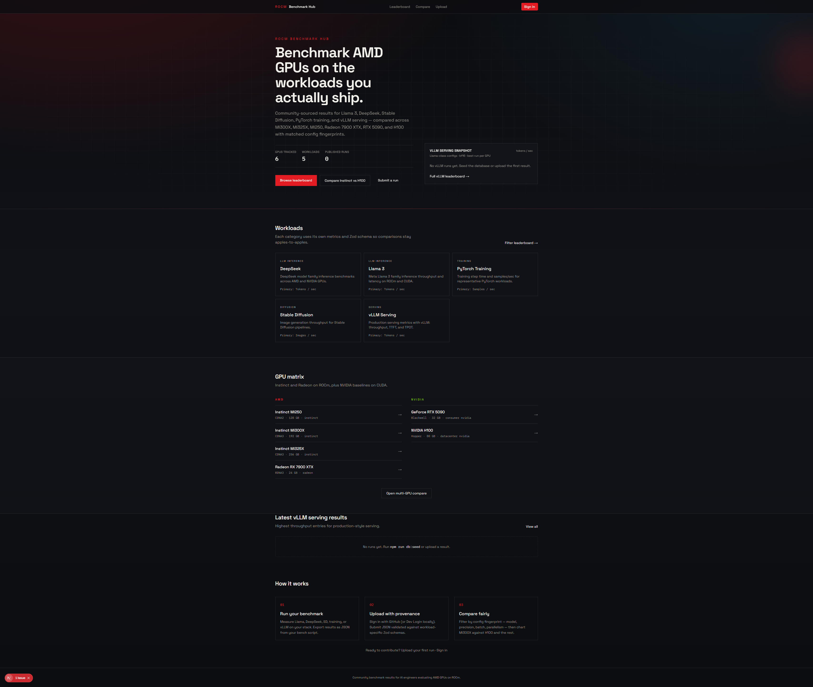

# ROCm Benchmark Hub

Compare AMD Instinct / Radeon and NVIDIA GPUs on Llama 3, DeepSeek, Stable Diffusion, PyTorch training, and vLLM serving.



## Home page (`/`)

The first page is the marketing and entry point for engineers evaluating AMD GPUs on ROCm. After `npm run dev`, open [http://localhost:3000](http://localhost:3000).

| Section | Purpose |
| -------- | -------- |
| **Hero** | Headline, live stats (GPUs / workloads / published runs), primary CTAs (leaderboard, compare, upload) |
| **vLLM snapshot** | Side panel with horizontal bars — best tokens/sec per GPU for vLLM serving |
| **Workloads** | Card grid linking to `/workloads/[slug]` with category and primary metric |
| **GPU matrix** | AMD vs NVIDIA lists linking to `/gpus/[slug]` |
| **Latest vLLM results** | Top five runs linking to `/runs/[id]` |
| **How it works** | Three-step flow: benchmark → upload → compare with config fingerprints |

Implementation:

- Route: [`src/app/page.tsx`](src/app/page.tsx)
- UI sections: [`src/components/home/`](src/components/home/) (`landing-hero.tsx`, `workload-strip.tsx`, `gpu-matrix.tsx`, `how-it-works.tsx`)
- Theme tokens: [`src/app/globals.css`](src/app/globals.css) (AMD red accent, dark background)
- Screenshot: [`docs/homepage.png`](docs/homepage.png) (refresh after UI changes with `npm run capture:readme` while `npm run dev` is running)

Populate demo data so the hero stats and charts are non-empty:

```bash
npm run db:seed
```

## Stack

- **Next.js** (App Router) + TypeScript + Tailwind
- **PostgreSQL** via Neon in production; **PGlite** locally when `DATABASE_URL` is unset
- **Drizzle ORM** + **Zod** upload schemas
- **Auth.js** (GitHub OAuth + local Dev Login)
- **Recharts** leaderboards
- **Cloudflare R2** for optional artifacts

## Quick start

```bash
npm install
cp .env.example .env.local
npm run db:seed
npm run dev
```

Open [http://localhost:3000](http://localhost:3000) for the home page.

Sign in with **Dev Login** on `/login` (no GitHub app required locally), then upload JSON at `/upload`.

## Environment

| Variable | Purpose |
|----------|---------|
| `AUTH_SECRET` | Auth.js session secret |
| `AUTH_GITHUB_ID` / `AUTH_GITHUB_SECRET` | GitHub OAuth |
| `DATABASE_URL` | Neon connection string (optional locally) |
| `ROCM_DB_PATH` | Local PGlite directory (seed script sets `.data/pglite` by default) |
| `R2_*` | Cloudflare R2 artifact uploads |

## Upload schema

Workload keys: `vllm_serving`, `llama3`, `deepseek`, `stable_diffusion`, `pytorch_training`.

GPU `name` must match the catalog exactly, e.g. `Instinct MI300X`, `NVIDIA H100`.

See the example on `/upload` or `src/lib/schemas/upload.ts`.
